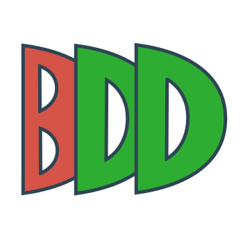
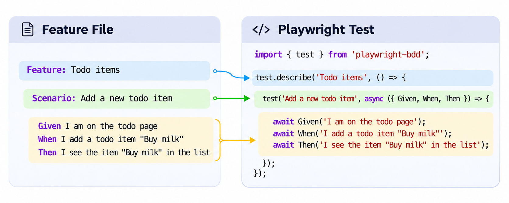
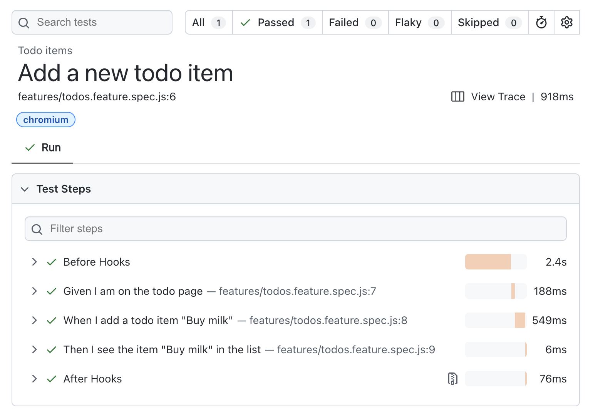

<!-- this file differs from README.md in project root -->

<div align="center">
  <a href="/">
    
  </a>
</div>

<h1 align="center">Playwright-BDD</h1>

<div align="center">

Run [BDD](https://cucumber.io/docs/bdd/) tests with [Playwright](https://playwright.dev/) runner

</div>

## Quick start
Jump to the [getting started](getting-started/index.md) guide or read below the overview of Playwright-BDD project.

<!-- Keep absolute urls to easily update from README.md -->

## BDD in the Era of AI

[Behavior-Driven Development (BDD)](https://cucumber.io/docs/bdd/) describes product requirements as `Given / When / Then` scenarios written in plain-text format:

```gherkin
Feature: Buying a pizza

  Scenario: Success order
    Given I am on the "Pepperoni" pizza page
    When I add 2 pizzas to the cart
    And I complete checkout
    Then I see an order confirmation:
      | Product  | Pepperoni  |
      | Quantity | 2          |
```

 In the AI era, these scenarios become valuable artifacts for agents because they are both:

* ✅ **Readable**: You can easily draft and refine scenarios with an agent to clearly define the behavior.
* ✅ **Executable**: The same scenarios can be executed as automated tests to verify the implementation.

Unlike plain Markdown specs, BDD does not just describe a feature; it makes the spec live and keeps it aligned with the codebase.

Watch the  [1-minute workflow overview](https://www.youtube.com/watch?v=hDL9j23EDNs) or read the [blog post](https://vitalets.github.io/posts/bdd-agentic-workflow/) to see agentic BDD in action. The ultimate goal: **review only feature files** and let automated guardrails check code quality and scenario compliance.

To bring this workflow to your project, [set up Playwright-BDD](https://vitalets.github.io/playwright-bdd/#/getting-started/index) and add the [playwright-bdd skill](https://vitalets.github.io/playwright-bdd/#/getting-started/agent-skill) for your AI coding agent.

## Why Playwright Runner?

Playwright can be used as a [browser automation library](https://playwright.dev/docs/library) with any test runner, such as CucumberJS or Vitest. However, it is most powerful when used with the **Playwright test runner**. Playwright-BDD converts BDD scenarios into native Playwright tests, so you get all Playwright runner features out of the box:

- Automatic browser setup and cleanup
- Auto-waiting for page elements
- Auto-capture of screenshots, videos, and traces
- Parallel execution and sharding
- Built-in reports and visual comparison testing
- Playwright fixtures
- [...and more](https://playwright.dev/docs/library#key-differences)

<!-- Keep absolute urls to easily update from README.md -->


## How Playwright-BDD works
A typical command to run tests with Playwright-BDD is:
```
npx bddgen && npx playwright test
```

### Phase 1: Generate tests
The first command `npx bddgen` generates test files from BDD feature files. For example:



### Phase 2: Run tests
The second command `npx playwright test` runs the generated files with the Playwright runner.
Step definitions have access to the Playwright APIs and can interact with browser pages:

```js
Given('I am on the todo page', async ({ page }) => {
  await page.goto('https://www.todoaapp.com');
});

When('I add a todo item {string}', async ({ page }, name) => {
  await page.getByRole('button', { name }).click();
});

Then('I see the item {string} in the list', async ({ page }, text) => {
  await expect(page.getByRole('button')).toHaveTitle(new RegExp(text));
});  
```

HTML report shows all scenarios and steps:



Proceed to the [installation guide](getting-started/installation.md) and try it yourself.